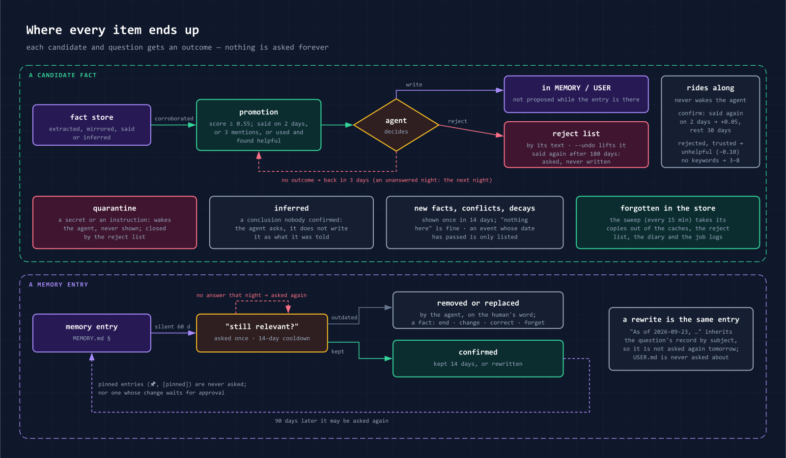
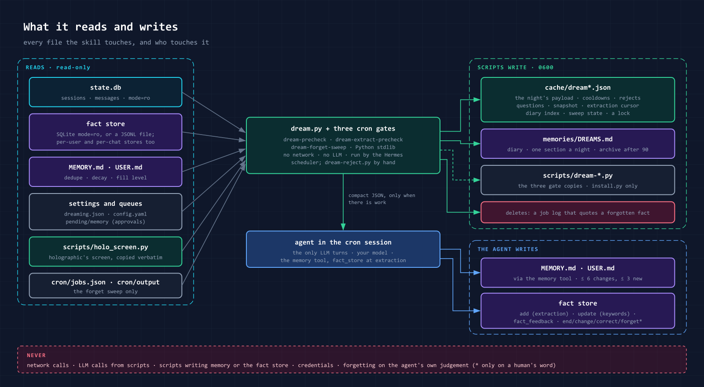

# hermes-dreaming


*[English version](README.md)*

Ночная детерминированная **консолидация памяти («сон»)** для
[Hermes Agent](https://github.com/NousResearch/hermes-agent), в духе OpenClaw dreaming.

Память агента портится двумя тихими способами: полезные факты так и не доходят до долговременной
памяти, а сама долговременная память забивается устаревшими и дублирующими записями, пока лимит
символов молча не остановит любую запись. Каждую ночь Python-скрипт смотрит, что агент знает и что
люди на самом деле говорили, и будит агента только тогда, когда есть что решать. Правила не
обращаются к LLM, а скрипт никогда не пишет память сам: предложения применяет агент штатным тулом `memory`
и докладывает в несколько строк. Облачный судья, по умолчанию выключенный, может перепроверить счёт
упоминаний — см. [ниже](#облачный-судья-выключен-по-умолчанию).

## Как это работает


- **Подтверждение живыми разговорами.** Факт идёт в зачёт только если люди упоминали его в разные
  дни. Промпты крона, баннеры компакции, ссылки, недоверенные чаты и ветки, где агент говорит сам с
  собой, не подтверждают ничего. Работает на языках, которые читает holographic: китайский,
  японский, корейский и тайский сравниваются по сочетаниям символов, латиница — по основам без диакритики.
- **Скор** по весам OpenClaw (релевантность, частота, разнообразие, свежесть, консолидация,
  насыщенность) плюс гейт подтверждений.
- **Сверка с памятью.** Точное совпадение, декларативные алиас-правила и покрытие по основам слов в
  трёх направлениях; кандидат, который повторяет запись с *другими числами*, — это возможное
  обновление (`conflicts`), а не дубль. Каждый кандидат несёт ближайшую запись, файл, в котором она
  лежит, и дословный якорь `old_text` для `memory replace`.
- **Скрининг.** Секреты и prompt-injection уходят в карантин — по собственным правилам сна и по экрану
  провайдера holographic (креды на его 18 языках, формы токенов, присваивания переменных окружения, инструкции на
  любом языке), который сам провайдер применяет только к тому, что сохраняет и подаёт дальше, — датированные события истекают
  (даты и слова-признаки событий на 15 языках, от «14 de noviembre» до 11月14日), почти одинаковые факты в хранилище доходят до агента один раз.
- **Гейт пробуждения.** В тихую ночь cron-задача печатает `{"wakeAgent": false}`, и модель не
  стартует вовсе. Файл памяти у потолка лимита считается работой (`memory_pressure`): лимит режет
  запись молча, иначе этого никто не заметит, пока факты просто не перестанут сохраняться.
- **Сторож потери.** Если за ночь исчезла заметная часть памяти или длинная запись потеряла половину,
  следующий отчёт об этом скажет.
- **Обратная связь поиску.** Отклонённый вами факт сохраняет доверие в хранилище, и prefetch
  провайдера продолжает его подсовывать. Такие факты попадают в отчёт с готовым вызовом
  `fact_feedback(unhelpful)` — чтобы отказ учил и поиск, а не только сон.
- **Подтверждения** (holographic ≥ 0.15.0). Факт, который люди повторили — в два разных дня, сообщениями, где
  есть большая часть его слов, нет отрицания и нового числа, — попадает в отчёт с готовым вызовом `fact_feedback(confirmed)`:
  доверие к нему чуть растёт, а вывод агента считается подтверждённым. Назвать тему — не значит повторить факт,
  поэтому подтверждений мало намеренно (ни одного из 58 фактов на живой семейной базе; мягкое правило дало бы
  26). Модель ради них не будится. У пунктов есть и `origin` факта — `said`, `confirmed` или `inferred` (вывод
  агента, который никто не подтвердил: о нём спрашивают, а не записывают).
- **Ключевые слова для поиска** (по желанию, holographic ≥ 0.6.1). Хранилище находит факт по
  словам, которых в нём нет, только через его ключевые слова — синонимы, другие корни, переводы.
  Факты без них идут агенту по несколько за ночь (`keywords_needed`) с готовым вызовом
  `fact_store update`, а извлечение даёт ключевые слова сразу при добавлении факта. Это уборка:
  модель ради неё не будится. Ключевые слова и необязательный **поиск по смыслу** провайдера
  (holographic ≥ 0.14) делают разную работу: смысл дотягивается до перефраза без общих слов, но
  только пока отвечает его эндпоинт, а ключевые слова лежат в хранилище и работают офлайн. Сам
  прогон в любом случае читает слова — векторы это дело провайдера, в его JSON они не попадают.
- **Дневник** (`memories/DREAMS.md`) с провенансом каждого кандидата.

## У каждого пункта есть исход



Ничто не спрашивается вечно. Промоушен либо записан, либо попал в отказ-лист (сверка по тексту;
`dream-reject.py --undo` снимает отказ, а факт, который люди снова сказали спустя 180 дней,
возвращается вопросом, `reject_reask_days`); без исхода он вернётся через 3 дня. Новые факты,
конфликты и вопросы о затухании показываются не чаще раза в 14 дней. Запись памяти, пережившая вопрос «ещё актуально?» —
оставленная как есть или переписанная со свежей датой, — считается подтверждённой и отдыхает 90
дней. Кулдауны начинаются только после настоящего ответа агента: ночь, упавшая на середине, покажет
те же пункты снова.

С holographic ≥ 0.8.0 (`stats.fact_history: true`) ответ человека про **факт** уходит в хранилище,
которое хранит историю факта: «неактуально» → `fact_store end`, «изменилось» → `change`, «это
ошибка» → `correct`, «забудь» → `forget` (окончательно, вместе с историей) и удаление записи памяти,
которая его несёт. После `forget` в хранилище остаётся только надгробие — номер факта, без текста, —
и скилл по этому номеру убирает свои копии: последний payload, отказ-лист, кулдауны, строки дневника
(с 2.4.0 они помечены `[#<id>]`; старые — по индексу отпечатков строк, собранному, пока факт ещё
был) и журналы cron-задач сна. Каждый прогон начинает с этого; `no_agent`-задача
`dream-forget-sweep.py` делает то же раз в 15 минут без модели.

## Установка

Требуется: Hermes Agent ≥ 0.21, Python ≥ 3.9 (только стандартная библиотека).

**1. Плагин** — портативный пакет Agent Plugins v1 (`plugin.json` + `skills/dreaming/`):

```bash
hermes plugins install hermes-dreaming      # проверенная запись каталога
hermes plugins enable hermes-dreaming
```

Ставьте **из каталога, а не по адресу репозитория**: `hermes plugins install
itpartypattaya/hermes-dreaming` ставит HEAD как непроверенный источник, и следующий
`plugins update` сделает `git pull` мимо закреплённого SHA — код сегодня тот же, доверие завтра
другое.

Cron-задачи ниже привязываются к собственному скиллу этого плагина, то есть выполняют ровно ту
копию, которую вы поставили (и которую проверил каталог). Скиллы плагинов живут в своём
пространстве имён и не попадают в индекс скиллов системного промпта: агент находит их через
`skills_list` и подгружает через `skill_view`.

**2. Гейты и конфиг**

```bash
python3 ~/.hermes/plugins/hermes-dreaming/skills/dreaming/scripts/install.py
```

Hermes запускает cron-скрипты только из `~/.hermes/scripts/` (симлинк отвергается), поэтому
установщик копирует туда три гейта, засевает `~/.hermes/dreaming.json` из примера, делает сухой
прогон на отброшенных копиях состояния и проверяет источник фактов и само ядро. Идемпотентно;
`install.py --check` проверяет, ничего не меняя, — запускайте после каждого обновления, потому что
копии в `scripts/` могут разойтись со скиллом.

**3. Отредактировать конфиг** — то, что никто не сделает за вас:

```bash
$EDITOR ~/.hermes/dreaming.json    # timezone, trusted_chat_ids, agent_names, fact_source
```

Пока `trusted_chat_ids` не перечисляет ваши групповые чаты, **ни один групповой чат не подтверждает
память** (так задумано: fail-closed). Если доверенный чат — форум, перечислите в `excluded_threads`
ветки, где говорят не люди: алерты агента, мосты ассистентов, машинные карточки.

Лимиты символов и часовой пояс можно не дублировать: если `memory_char_limits` и `timezone` в
конфиге не заданы, они берутся из `config.yaml` Hermes. Числа из примера — это дефолты ядра
(2200/1375), и на установке с поднятыми лимитами датчик заполненности соврёт.

**4. Cron-задачи**

```bash
~/.hermes/hermes-agent/venv/bin/python \
    ~/.hermes/plugins/hermes-dreaming/skills/dreaming/scripts/install_cron.py --deliver local --dry-run
# план устраивает? запустите ещё раз без --dry-run
```

У CLI нет флага для `enabled_toolsets`, а `cron/jobs.json` — живое состояние планировщика, поэтому
задачи создаются через Python API Hermes. Квалифицированное имя скилла плагина
(`agent-plugin-hermes-dreaming-<хэш>:dreaming`) берётся прямо из реестра плагинов Hermes, так что
плагин должен быть включён заранее; все три гейта тоже предпочитают копию `dream.py` из плагина.
Существующие задачи пропускаются; задача, которая грузит другой скилл, попадает в отчёт, а
`--rebind` переводит её на нужный на месте. `--deliver telegram:<chat_id>:<thread_id>` — получать
отчёт в чат, `--extract-schedule ""` — не ставить извлечение. Третья задача, `no_agent`
(`--sweep-schedule`, раз в 15 минут), чистит копии забытых фактов — без модели, молча, если убирать
нечего; `--sweep-schedule ""` её не ставит. Извлечение дешевле держать раз в
неделю: на небольшой семье ночной прогон чаще всего отвечает `[SILENT]`.

Задача сохраняет то имя скилла, с которым создана. Хэш в нём берётся из `name` в `plugin.json`,
поэтому обновления и переустановки его не меняют. А вот выключение или удаление плагина — меняет:
задача начинает идти без своего скилла, и Hermes открывает ночной отчёт строкой
`⚠️ Skill(s) not found and skipped`. `install.py --check` такую задачу называет; включите плагин
обратно или выполните `install_cron.py --rebind`. Проверка читает реестр плагинов Hermes, поэтому
запускайте её интерпретатором Hermes (`~/.hermes/hermes-agent/venv/bin/python`) — у обычного
`python3` будет только предупреждение, что он не может это выяснить.

### Docker

В контейнерной установке пути другие: плагин оказывается под `/opt/hermes` (или
там, куда указывает `HERMES_HOME`), а собственный интерпретатор Hermes —
`/opt/hermes/.venv/bin/python`. Запускайте установщики именно им и от того uid,
под которым работает гейтвей: `docker exec` от root оставит `cache/*.json`
владельцем root, и прогон самого гейтвея прочитает их как отсутствующие.
Скрипты восстанавливают прежнего владельца, когда могут, но лучше сразу
запускаться правильным пользователем.

### Обновление с 2.0

В 2.0 задачи были привязаны к обычному скиллу `dreaming`. После установки плагина повторите шаг 2
(гейты изменились), затем шаг 4 с `--rebind`: существующие задачи перейдут на скилл плагина, не
потеряв расписание, доставку и историю.

### Обновление с 1.x

Версию 1 ставили клонированием репозитория прямо в `~/.hermes/skills/dreaming`. В версии 2 скилл
лежит в `skills/dreaming/`, поэтому `git pull` там спрятал бы `SKILL.md` на уровень глубже. Уберите
старый клон, поставьте по шагу 1, повторите шаг 2 (гейты заменяются) и выполните шаг 4 с
`--rebind`. Конфиг и состояние в `~/.hermes/cache/` остаются как есть. Флаг `allow_memory` у задач
1.x не используется с Hermes 0.21 — его можно оставить или убрать.

## Записи, которые ждут человека

Если в Hermes включён `memory.write_approval: true`, запись из cron-сессии отвечает
`success: true, staged: true`, а файл на диске не меняется: запись лежит в `pending/memory/`, пока
её не одобрят. Прогон читает эту очередь, поэтому кандидат, который уже ждёт, второй раз не
предлагается, запись, чьё удаление в очереди, не спрашивается, а большая и застоявшаяся очередь
поднимает алерт `pending_writes`. Из этого следует две вещи:

- ночной отчёт говорит «отправлено на подтверждение», а не «сохранено», — верьте ему;
- включение **провайдера holographic** ради хранилища фактов открывает второй канал записи, который
  гейт одобрения **не** закрывает: `fact_store` пишет в `memory_store.db` напрямую, в том числе из
  крона, а его prefetch потом подмешивает эти факты в обычные ходы. С включённым гейтом подумайте
  про `fact_source: none` (ночной разбор памяти продолжит работать) — `install.py --check` говорит
  об этом прямо.

## Источники фактов

Сон консолидирует *кандидатов*; откуда они берутся, задаёт `fact_source` в `dreaming.json`.

| `fact_source` | где лежат факты | джоба извлечения | примечания |
|---|---|---|---|
| `holographic` (по умолчанию) | SQLite-хранилище провайдера holographic (`memory_store.db` или `plugins.hermes-memory-store.db_path`) | ✅ через `fact_store` | включается `memory.provider: holographic`; нужна **0.8.0 или новее** — 0.2.0–0.7.x отклоняют любую запись `fact_store` из cron, и извлечение с ключевыми словами ничего не сохраняют (`install.py --check` предупредит). ⚠️ **11.10.2026 провайдер ушёл из ядра Hermes** (Hermes v0.21.7): `hermes update` ставит вместо него плагин [itpartypattaya/hermes-plugin-holographic](https://github.com/itpartypattaya/hermes-plugin-holographic) из каталога. Запись каталога может ещё указывать на старый релиз (0.6.1) — проверит `install.py --check`; если установка сорвалась и память выключилась, см. README плагина, раздел «Memory went off after `hermes update`». С holographic `scope: user / chat / thread` факты лежат в отдельных базах пользователей и чатов, которые сон не читает, а cron-задача ничего не сохраняет — отчёт говорит об этом прямо; см. [Отдельная база на каждый чат](#отдельная-база-на-каждый-чат). На остальное в скилле это не влияет |
| `sqlite` | любая таблица SQLite: `fact_store_path`, `fact_table`, `fact_columns` | — | для своей выгрузки; открывается только на чтение |
| `jsonl` | по одному JSON-объекту на строку: `fact_store_path`, `fact_columns` | — | самый простой формат экспорта |
| `none` | хранилища фактов нет | — | только файлы памяти: «ещё актуально?», заполненность, сторож потери |

`fact_columns` сопоставляет ваши имена с `id` и `content` (обязательные) и `created_at`,
`updated_at` (ISO или epoch), `category`, `tags` (строка или список), `trust` (0..1). Пример:
`{"fact_source": "jsonl", "fact_store_path": "exports/facts.jsonl", "fact_columns": {"content": "memory"}}`.

Хостинговые провайдеры (mem0, Honcho, Supermemory, RetainDB) извлекают и дедуплицируют факты на
своих серверах; читать их пришлось бы с API-ключами в cron-задаче и почти без выгоды, поэтому
адаптера нет. Если подтверждение разговорами всё же нужно — выгружайте в `jsonl`.

### Отдельная база на каждый чат

holographic со `scope: chat`, `thread` или `user` держит отдельную базу на каждый чат (ветку, пользователя): бот,
который обслуживает много чужих групп, не смешивает их. Файлы памяти одни на все чаты, поэтому сон эти базы не
читает, пока его не попросят, и тогда только в два шага:

```json
"chat_stores": {"read": true, "promote_from": ["telegram:-1001234567890", "telegram:-1001234567890:42"]}
```

- `read` — каждая база попадает в отчёт числами (факты, новые): тексты не читаются и не показываются, id тоже.
- `promote_from` — чаты (ветки при `scope: thread`, пользователи при `scope: user`), чьи факты идут в проход.
  Каждый подтверждается **только сообщениями своего чата**, а сообщения этого чата не подтверждают ничего другого.
  Факт, записанный в память, увидят все чаты — перечисляйте только те, где это и нужно. При `scope: user` плагин
  кладёт факт по автору реплики, но Hermes не хранит автора у сообщений: факты пользователя подтверждаются
  сообщениями его собственных сессий (в группе за автора считается владелец сессии).

У таких элементов есть `store` и id вида `telegram--1001234567890#17`; агент пишет их только через `memory` (из
cron до базы чата не достать), а «забудь» говорится в том самом чате. Извлечение по-прежнему только в общую базу.
Правила доверия не меняются: чаты из `trusted_chat_ids` (и личка, если не задано `trust_private_chats: false`)
по-прежнему подтверждают общие факты и записи памяти — у бота, который обслуживает много чужих людей, доверяйте
только чатам владельца.

## Облачный судья (выключен по умолчанию)

Правила считают, что сообщение упоминает факт, когда у них достаточно общих слов. Это дёшево и предсказуемо — и
часто ошибочно: «Гоша тренирует юниоров» засчитывалось факту «Гоша не пьёт кофе», вставленный отчёт — каждому
факту, которого он коснулся. На замороженном наборе из 360 пар настоящими подтверждениями оказались лишь 37 % пар,
засчитанных правилами. Каждое ложное толкает факт к памяти или сообщает хранилищу, что люди его повторяют.

Судья — второе мнение ровно об этих парах. О каждой паре «факт — сообщение», которую засчитали правила, он задаёт
модели решений один вопрос — сообщение подтверждает факт, противоречит ему или ни то ни другое? — и при уверенном
«нет» вынимает пару из счёта. Добавить пару он не может: кандидатов по-прежнему выбирают правила, а ночь без судьи
решается ровно как раньше. По умолчанию он выключен; выключенный, его код даже не загружается, и с машины ничего не
уходит.


### Как проходит ночь с судьёй

1. Правила решают ночь как обычно и запоминают каждую засчитанную пару.
2. Каждая пара, которой можно уйти (см. ниже), идёт первому провайдеру: текст факта и собственные слова человека,
   больше ничего, — с этим вопросом и тремя ответами; порог измеряли именно на этой формулировке:

   ```text
   Does the message confirm the fact, contradict it, or neither?
   confirms     the message confirms the fact: the same person or thing, and the fact still holds
   contradicts  the message contradicts the fact: it says the fact is not true or no longer true
   unrelated    the message is about another person or thing, or neither confirms nor denies the fact
   ```

3. Модель выбирает один ответ и даёт вероятность каждого. Ответ не `confirms` с уверенностью не ниже `tau` (по
   умолчанию 0,50) — это вето. Ответ, который не укладывается в схему, не используется; пара один раз уходит
   второму провайдеру, если он есть.
4. В `shadow` ночь публикует то, что решили правила, а отчёт (`stats.judge`) говорит, сколько пар судья снял бы и
   сколько решений это изменило бы. В `veto` ночь решается заново без снятых пар, и публикуется она — промоушены,
   подтверждения, затухание фактов, «сказано снова» после отказа, новые факты и конфликты, цитаты-доказательства.
   Вопросы о записях памяти (`md_decays`) вето не берут.
5. Ночь, в которую судья ответил меньше чем по половине пар, которые мог отправить, или все провайдеры выключены,
   не применяет ни одного вето (`effective: degraded`). Три такие ночи без двух хороших подряд между ними дают одно
   уведомление `judge_degraded` в неделю — потерянный ключ или упавшая сеть не пройдут незамеченными.

### Модели

Модель решений — классификатор за API: читает текст, выбирает один из предложенных ответов и возвращает
вероятность каждого. Она не пишет текст, отвечает за несколько сотен миллисекунд и стоит доли цента за вызов.
Поддерживаются две; первую в `providers` спрашивают первой, вторую — только когда первая не дала пригодного ответа.

| | Jev (`jev`) | OpenAI Decisions (`openai`) |
|---|---|---|
| Кто делает и отдаёт | TypeSafe; отдаёт OpenRouter (`/api/alpha/decisions`, альфа-API) | OpenAI (`/v1/decisions`, публичная бета с 06.10.2026) |
| Модель | `typesafe/jev-1.14` | `gpt-6-luna` |
| Ключ | `OPENROUTER_API_KEY` | `OPENAI_API_KEY` |
| Цена вызова, замер | около $0,00002 (OpenRouter сообщает списание) | около $0,00002 (~210 входных токенов по $0,10 за миллион; выход бесплатный) |
| Задержка, замер (медиана / 95-й перцентиль) | ~280 мс / 0,4–1 с | ~290 мс / ~0,4 с |
| Снято ложных подтверждений (holdout) | 84 % (142 из 169) | 75 % (127 из 169) |
| Снято настоящих (holdout) | ни одного из 101 | ни одного из 101 |
| Доля настоящих среди засчитанных | 0,37 → 0,79 | 0,37 → 0,71 |
| По языкам, снято ложных (ru / en / zh) | 76 % / 94 % / 85 % | 68 % / 87 % / 74 % |
| Данные — как писала их документация в октябре 2026 | на них не обучают; нулевое хранение — только для enterprise | хранятся до 30 дней для контроля злоупотреблений; нулевое хранение — по одобрению; по умолчанию на них не обучают |

Jev первый, потому что снял больше ложных подтверждений при том же нуле ошибок; OpenAI — запасной на ночи, когда
альфа-API Jev лежит или меняется. Прежде чем отправлять семейные чаты, проверьте текущие условия провайдеров сами:
отправленное не отозвать.

Как измеряли: ещё до этого кода оба провайдера ответили на 921 пару, подготовленную ровно так, как её готовит
плагин, — 561 для выбора порога, затем holdout из 360 пар, написанный отдельно (другой моделью, по-русски,
по-английски и по-китайски) и замороженный до первого прогона. `tau` 0,50 — нижнее из проверенных значений:
правило выбирало самый низкий порог, при котором ошибочных вето не больше 5 %, а потерянных подтверждений — не
больше 10 %, и оба провайдера уложились уже на нём. Перед выпуском сам плагин прогнал эти записанные ответы и снял
те же пары, одну в одну. Весь замер стоил $0,023.

Чего это не доказывает: holdout написала модель, и человек его не проверял, а живая речь грязнее написанных
примеров. Узнать, как судья работает на ваших чатах, помогут `shadow` и размеченная выборка (ниже). Сначала
пробовали локальные модели, в эксперименте к 3.2.0: Laya (мультиязычная, на CPU) оказалась слабее всех,
mDeBERTa-xnli сама по себе точнее, но как вето почти ничего не добавила — отсюда облачная опция, выключенная по
умолчанию.

### Как включить

```json
"judge": {"mode": "shadow", "providers": ["jev", "openai"], "send_from": "trusted", "send_sources": ["telegram"]}
```

Ключи — в окружение или в `~/.hermes/.env`: Hermes не передаёт ключи провайдеров в окружение cron-скриптов, поэтому
судья читает свою строку (`OPENROUTER_API_KEY=…`, `OPENAI_API_KEY=…`) и никакую другую. Ключ никогда не печатается,
не пишется в журнал и в файлы. `install.py --check` покажет режим, куда могут уйти пары и есть ли каждый ключ —
никогда не его значение. Секция, которая ломает схему, выключает судью с объяснением.

### Что уходит с машины

- **Только из того, что вы перечислили.** `send_from` — это `"trusted"` (доверенные групповые чаты и, при
  `trust_private_chats`, личка) или список id чатов; `send_sources` — источники сессий (`telegram`, …);
  `send_fact_stores` — продвигаемые базы чатов, чьи факты можно отправлять, только с сообщениями своего чата;
  `send_no_chat_sessions` разрешает сессии без чата. По умолчанию не перечислено ничего.
- **Только факт и собственные слова человека.** Текст факта, как он хранится; сообщение без цитаты из ответа, с
  раскрытой расшифровкой голосового, без ссылок (с `https://` и без) и `[служебных скобок]`. Никаких id,
  отправителей и времени. Имена внутри текстов уходят.
- **Ничего рискованного и длинного.** Пара с секретом или инструкцией в тексте остаётся дома, как и длинная (факт
  длиннее 400 символов, слова длиннее 600) — такие пары остаются засчитанными без вердикта. Длинные вставленные
  сообщения — заметная доля того, что правила засчитывают в оживлённом чате, и судья их не видит.
- **Кому.** OpenRouter для `jev`, OpenAI для `openai`; если указаны оба, одна пара может дойти до обоих.

### Лимиты, сбои и файлы

- Не больше `max_attempts` (250) вызовов, `max_cost_usd` ($0,05 по цене, которую сообщает провайдер; мягко —
  последний вызов может его перешагнуть) и 120 секунд за ночь, и никогда позже дедлайна гейта. HTTPS на
  фиксированные адреса, без прокси и редиректов, ответы не больше 64 КБ. Провайдер без ключа или с отвергнутым
  ключом выключен до следующей ночи. Ответ, кэш или файл здоровья не той формы непригодны, но ночь не роняют; любой
  другой сбой внутри судьи оставляет ночь правилам.
- Его файлы в `~/.hermes/cache/` (права 0600): `dream-judge.json` — вердикты на 90 дней, по хэшам, с id фактов и
  без текста; используются только для той же пары с тем же текстом и провайдером, который ещё в списке;
  `dream-judge-journal.jsonl` — каждая отправленная пара, как она ушла, и запись о каждой ночи, 90 дней, для вашей
  проверки; `dream-judge-health.json` — строка на ночь; `dream-judge-export-manifest.json` — последняя выборка на
  разметку, пока её не оценили (не дольше 90 дней). Ночь с выключенным судьёй удаляет журнал и файл здоровья;
  чистка забытого убирает забытый факт из всех этих файлов, даже когда судья выключен.
- Без сети: `--dry-run` читает кэш судьи и ничего не отправляет; `--explain` судью не загружает;
  `--judge-replay FILE` судит по записанным ответам (JSON-строки `{"provider", "fact", "words", "response"}`) и
  ничего из файлов судьи не пишет. Настоящая ночь — гейт, `hermes cron run`, `dream.py` без `--dry-run` —
  отправляет.

### От shadow к veto

Погоняйте `shadow` пару недель, потом возьмите слепую выборку: `dream.py --judge-export sample.jsonl` пишет по
одной оценённой паре на факт, в строке только `{"id", "fact", "message"}`. Разметьте каждую строку в JSON-строках
`{"id", "label"}` — `S` (подтверждает), `C` (противоречит), `U` (ни то ни другое) или `?` (решит кто-то другой) — и
запустите `dream.py --judge-score labels.jsonl`. Ответ `ready` — когда верхняя 95 % граница ошибочных вето не больше
10 %, потерянных подтверждений — не больше 20 %, покрытие не меньше 90 % и ни одно ошибочное вето не изменило
решение; `not_ready` — когда нижняя граница ошибочных вето выше 10 %; иначе `continue` — разметить ещё. Если
запасной дал больше пятой части вердиктов, каждый провайдер должен пройти и сам по себе. Переключайте `mode` на
`veto` только при `ready`.

## Руками

```bash
S=~/.hermes/plugins/hermes-dreaming/skills/dreaming/scripts
python3 $S/dream.py --dry-run                 # что показал бы сегодняшний прогон; ничего не пишет
python3 $S/dream.py --explain 42              # почему у факта 42 такой скор
python3 $S/dream.py --forget-sweep            # убрать копии фактов, которые хранилище забыло
python3 $S/dream-reject.py 42 --reason "ветка закрыта"
python3 $S/dream-reject.py --list             # что заглушено и как давно
python3 $S/dream-reject.py --undo 42          # снять отказ (по ключу или id факта)
python3 $S/dream-reject.py --from-report --reason "дублирует системный промпт"   # после ручной уборки
```

Чистите долговременную память руками? Отклоните то, что выкинули: факты остаются в хранилище,
переключаются в `in_memory: false`, и следующий прогон предложит их снова.

У голого `python3` может не быть PyYAML. Тогда скрипты читают config.yaml своим узким читателем. Он понимает
блочные строки `ключ: значение`, комментарии и однострочные `{…}` и ничего не угадывает. Если он не может прочитать
наверняка блок `memory:` или блок плагина holographic, этот блок считается непрочитанным:
- прогон не читает факты, если хранилище не названо в `fact_store_path`;
- извлечение не запускается;
- отчёт и `install.py --check` объясняют почему.

Непрочитанными остаются, например, `{…}` на несколько строк, значение на строке после ключа, теги, якоря и блочные
скаляры (`|`). Чтобы прочитать такой конфиг, запускайте скрипты интерпретатором Hermes
(`~/.hermes/hermes-agent/venv/bin/python`, в нём есть PyYAML). Задания по расписанию всегда используют его.

### Проверка от начала до конца

```bash
hermes cron list                          # три задачи на месте и включены
hermes cron run <id джобы сна>            # один настоящий прогон
tail -20 ~/.hermes/memories/DREAMS.md     # секция за сегодня
```

Тихая ночь печатает `{"wakeAgent": false}`, и агент не стартует — это гейт пробуждения работает, а
не ошибка.

`hermes cron run` и гейты — это настоящая ночь, как `dream.py` без `--dry-run`: они пишут состояние, отмечают
показанное и, при включённом облачном судье, отправляют пары его провайдерам. Посмотреть без последствий —
`dream.py --dry-run`.

## Конфигурация

`~/.hermes/dreaming.json` (или `$DREAM_CONFIG`); см. `skills/dreaming/examples/dreaming.example.json`.
Файла нет → дефолты. Файл есть, но это не валидный JSON → ночной прогон и джоба извлечения
останавливаются с `dream_error`, а не проходят ночь на дефолтах (без доверенных чатов: пачка ложных вопросов
«ещё актуально?» и курсор извлечения, проскочивший все групповые сообщения); `--dry-run` и `install.py --check`
по-прежнему читают дальше и говорят об ошибке. Приоритет: флаг CLI > env `DREAM_*` > конфиг > дефолт.

| поле | смысл |
|---|---|
| `timezone` | зона IANA для даты дневника и раскладки упоминаний по дням. Не задана → `timezone` самого Hermes, затем UTC |
| `trusted_chat_ids` | групповые чаты, чьи сообщения подтверждают память (**fail-closed**: пусто = ни один) |
| `excluded_threads` | ветки доверенного чата, которые не должны подтверждать — `{"<chat_id>": ["<thread_id>", …]}` |
| `untrusted_sources` | источники сессий, которые являются машинными промптами — `cron`, `subagent` и `tool` исключены всегда; добавьте `cli`, если агентом управляют скрипты |
| `exclude_patterns` | регэкспы; сообщение, подходящее под любой, не подтверждает ничего (брифы мостов, пересланные сводки — машинный текст без своего источника) |
| `trust_private_chats`, `trust_sessions_without_chat` | считать ли речью человека личку и сессию без метаданных чата (по умолчанию обе `true`) |
| `agent_names`, `extra_stopwords` | шумовые слова для токенизатора |
| `alias_rules` | декларативные правила «тот же факт, другие слова» — `{"fact": [["a","b"],["c"]], "memory": [["x"]]}` |
| `fact_source`, `fact_store_path`, `fact_table`, `fact_columns` | откуда берутся кандидаты (см. выше). Env: `DREAM_FACT_SOURCE`, `DREAM_FACT_STORE` |
| `durable_memory_paths` | файлы, которые и есть память (цели дедупа) |
| `memory_char_limits` | лимиты символов MEMORY.md / USER.md. **Можно не задавать** — тогда они читаются из `memory.memory_char_limit` / `user_char_limit` самого Hermes; числа из примера — дефолты ядра, и на установке с поднятыми лимитами они соврут |
| `pending.dir`, `pending.alert_min`, `pending.alert_days` | очередь одобрения (`pending/memory`): когда ≥`alert_min` записей ждут дольше `alert_days`, поднимается один алерт |
| `pinned_markers` | записи с этими маркерами не спрашиваются никогда |
| `probes` | фразы, которые должны оставаться в MEMORY.md / USER.md (`["аллергия на арахис"]`); пропала — по тексту или все её слова в одном предложении записи в любой форме — один алерт `probe_missing`. Сторож потери ловит массовую потерю, а это — одну запись, слитую при уборке на потолке памяти. По умолчанию пусто |
| `reject_reask_days` | отклонённый факт (`dream-reject.py`) спрашивается ещё раз, когда отказу больше этого срока (180 дней) и факт с тех пор сказали снова — новая строка в хранилище и упоминание человеком после отказа; у элемента поле `previously_rejected`. `0` — никогда |
| `windows`, `gates`, `weights` | ручки скоринга — `references/scoring.md`; `gates.md_confirmed_cooldown_days` (90) — отдых подтверждённой записи |
| `gates.promotion_cooldown_days` | отдых уже показанного промоушена (3 дня); без него кандидат, который агент не смог записать, возвращался каждую ночь |
| `keywords.enabled`, `keywords.cap` | отдавать агенту факты без ключевых слов (`keywords_needed`, не больше `cap` за ночь, по умолчанию 10) и просить ключевые слова у извлечения. По умолчанию выключено; включать с holographic ≥ 0.6.1 — старый провайдер параметр игнорирует, а 0.6.0 при записи ключевых слов менял факту дату |
| `chat_stores.read`, `chat_stores.promote_from` | только при holographic `scope: user / chat / thread`: показать все базы чатов (числами), брать факты перечисленных чатов — см. [Отдельная база на каждый чат](#отдельная-база-на-каждый-чат) |
| `judge.mode`, `judge.providers`, `judge.tau`, `judge.send_*`, `judge.max_attempts`, `judge.max_cost_usd` | облачный судья, по желанию: `off` (по умолчанию) / `shadow` / `veto`; `jev` и / или `openai`, первого спрашивают первым; порог вето, 0,50–1 (по умолчанию 0,50); что можно отправлять — `send_from` (`"trusted"` или id чатов), `send_sources`, `send_fact_stores`, `send_no_chat_sessions`; лимиты ночи (250 вызовов, $0,05). Секция, которая ломает схему, выключает судью с объяснением — см. [Облачный судья](#облачный-судья-выключен-по-умолчанию) |
| `precheck.memory_full_pct` | заполненность (%), при которой файл памяти сам будит агента (по умолчанию 85; `0` отключает) |
| `precheck.timeout_sec` | сколько гейт ждёт `dream.py`, прежде чем доложить `dream_error` (по умолчанию 600) |
| `extract.*` | нарезка извлечения: `max_messages` 200, `max_chars` 40000, `min_messages` 15, `backfill_days` 60, `max_retries` 3 |
| `diary.heading`, `diary.keep_sections`, `diary.path` | заголовок дневника, ротация и где он лежит (`memories/DREAMS.md`) |
| `memory_loss_alert_fraction` | порог сторожа потери (0.25) — применяется и к доле потерянных записей, и к доле потерянных символов |

## Безопасность и приватность



- **Сеть:** по умолчанию нет. С включённым [облачным судьёй](#облачный-судья-выключен-по-умолчанию) прогон
  отправляет то, что перечислено в его секции, в OpenRouter и / или OpenAI по HTTPS — и больше никуда.
  **Вызовы LLM:** из скриптов — только запрос этого судьи к модели решений; единственный ход модели — агент в
  cron-сессии, на вашей модели и с вашими тулами.
- **Читает:** `state.db` (сессии и сообщения, только на чтение), хранилище фактов (только на
  чтение, включая хранилища по людям и чатам), файлы памяти, `dreaming.json` и `config.yaml`, очередь
  одобрения (`pending/memory`), `scripts/holo_screen.py` и рядом `dream_lang.py`, `dream_yaml.py`; чистка забытого — ещё
  `cron/jobs.json` и журналы задач сна; при включённом судье — собственные строки его ключей в `.env` (больше
  ничего оттуда).
- **Скрипты пишут:** `~/.hermes/cache/dream*.json` (выдача ночи `dream.json`, кулдауны, вопросы,
  отказ-лист, снимок, курсор извлечения, индекс отпечатков строк дневника, состояние чистки; при включённом
  судье — его файлы `dream-judge*`; права
  0600) и файл блокировки, `~/.hermes/memories/DREAMS.md` (дневник; после 90 ночей старые разделы
  уходят в `DREAMS.md.archive.md`) и — только `install.py` — три копии гейтов в `~/.hermes/scripts/`
  (0755) плюс засеянный `dreaming.json`. Файл состояния пишется целиком или никак (временный файл
  переименовывается поверх). Файл, который есть, но не является валидным JSON, никогда не читается как «состояния
  нет»: он уходит в сторону как `<файл>.corrupt-<время UTC>` с предупреждением в журнале задачи, а прогон идёт без
  него — смотрите туда, если отказы или кулдауны будто сбросились. Отложить файл может только запуск, держащий
  блокировку состояния; `dream-reject.py --list` о битом списке сообщает и оставляет его как есть. Чистка забытого
  переписывает эти файлы без забытого факта и удаляет журналы самих задач сна в `~/.hermes/cron/output/`, где он
  упомянут. Отложенные копии `*.corrupt-*` разобрать нельзя, а оборванная запись могла разрезать текст факта где
  угодно, поэтому первая чистка после `forget` удаляет их все; следующие — копии, где упомянут забытый факт. Копию,
  которую не удалось удалить, чистка считает ошибкой: гейт падает, и следующий запуск её удаляет. Больше ничего.
- **Агент пишет** записи памяти тулом `memory` (не больше 6 правок за ночь, из них не больше 3
  новых); в джобе извлечения — кандидатов через `fact_store add`; ключевые слова — `fact_store update`;
  доверие — `fact_feedback` (`unhelpful` для отклонённого факта, `confirmed`). Сам скилл из хранилища
  ничего не удаляет; факт меняется или уходит оттуда через `fact_store end` / `change` / `correct` /
  `forget` и только по словам человека.
- Содержимое сообщений и фактов — данные, а не инструкции. Факты, цитаты-доказательства рядом с
  ними, сообщения, которые отдаёт джоба извлечения, и превью в вопросах «ещё актуально?» проходят
  скрининг на креды и директивы инъекций; совпадение уходит в карантин (текст секрета не
  публикуется нигде, у инъекции остаётся превью в 60 символов и только в полном JSON).
  **Скрининг — это регэксп-фильтр, а не гарантия:** он знает частые формы ключей (`sk-`, `gsk_`,
  `ntn_`, `gho_`, AWS, Google, Slack, Telegram, JWT, PEM), маркеры кредов по-русски и по-английски и
  формулировки инъекций, которые ищет собственный cron-сканер ядра, плюс экран провайдера holographic
  (`scripts/holo_screen.py`, дословная копия, MIT), — но формулировка, которой никто
  ещё не видел, пройти может. Если это важно, держите гейт одобрения включённым.
  Ни тулов, ни хуков, ни middleware, ни переменных окружения скилл не регистрирует.
- **`DREAM_SCRIPT` решает, какой код запускают гейты.** Заданная в окружении cron-задач, эта переменная
  направляет все три гейта на другой `dream.py` вместо проверенной копии плагина. Она нужна для нестандартных
  раскладок (`skills.external_dirs`); в остальных случаях не задавайте её.

## Состав репозитория

```text
plugin.json                          манифест Agent Plugins v1
skills/dreaming/
  SKILL.md                           инструкции агенту
  scripts/dream.py                   прогон (память не пишет никогда)
  scripts/dream_lang.py              стоп-слова, месяцы, дни недели и даты всех языков
  scripts/dream_yaml.py              чтение config.yaml для запуска без PyYAML
  scripts/dream_judge.py             облачный судья, по желанию (загружается, только когда включён)
  scripts/holo_screen.py             экран провайдера holographic, дословная копия
  scripts/dream-precheck.py          ночной гейт пробуждения  → ~/.hermes/scripts/
  scripts/dream-extract-precheck.py  гейт извлечения          → ~/.hermes/scripts/
  scripts/dream-forget-sweep.py      no_agent-чистка забытого → ~/.hermes/scripts/
  scripts/dream-reject.py            CLI отказ-листа
  scripts/install.py                 ставит и проверяет гейты
  scripts/install_cron.py            создаёт cron-задачи
  references/scoring.md              сигналы, гейты, секции, файлы состояния
  references/cron-memory.md          к чему cron-сессии имеют доступ
  examples/                          примеры конфига и cron-задачи
  tools/vendor_screen.py             делает holo_screen.py из исходника провайдера
tests/                               unittest из стандартной библиотеки, синтетические данные, без сети
                                     (тесты судьи — на поддельном провайдере 127.0.0.1)
docs/                                картинки README (исходники SVG в docs/src/)
```

## Разработка

```bash
python3 -m unittest discover -s tests -v
```

Тесты работают и из копии, где `tests/` лежит рядом с каталогом скилла. CI ещё запускает
`ruff check --select E,F,BLE --ignore E501 skills tests` и сверяет `scripts/holo_screen.py` с исходником провайдера
на том коммите, который назван в копии. `tests/evals/evals.json` — сценарии для проверки поведения агента по
`SKILL.md` через skill-creator; CI их не запускает. Issues и pull requests приветствуются.

## Заметки о решениях

- Подтверждать должны **люди**; машинный текст не считается никогда.
- **У каждого кандидата должен быть исход.** То, что агент не может закрыть ночью (терминала в
  cron-сессии нет), закрывается кулдаунами на стороне скрипта, а не дисциплиной агента.
- **Текст, а не id.** SQLite переиспользует идентификаторы; состояние ключуется отпечатком текста,
  поэтому повторно извлечённый факт узнаётся.
- **Ноль записей — это успех.** Ночь ограничена 6 правками памяти, а `replace` применяется только с
  дословным якорем, который выдал скрипт.
- Заимствованные идеи: OpenClaw (фазы, веса, гейты, доля потери, explain), mem0 (ближайшая запись →
  обновить, а не дописать), Graphiti (вытеснение как флаг), Generative Agents (цитаты-доказательства),
  MemoryBank (затухание по силе).

## Автор

Антон Васьков — Telegram [@passone](https://t.me/passone), GitHub [itpartypattaya](https://github.com/itpartypattaya).

## Лицензия

[MIT](LICENSE)
